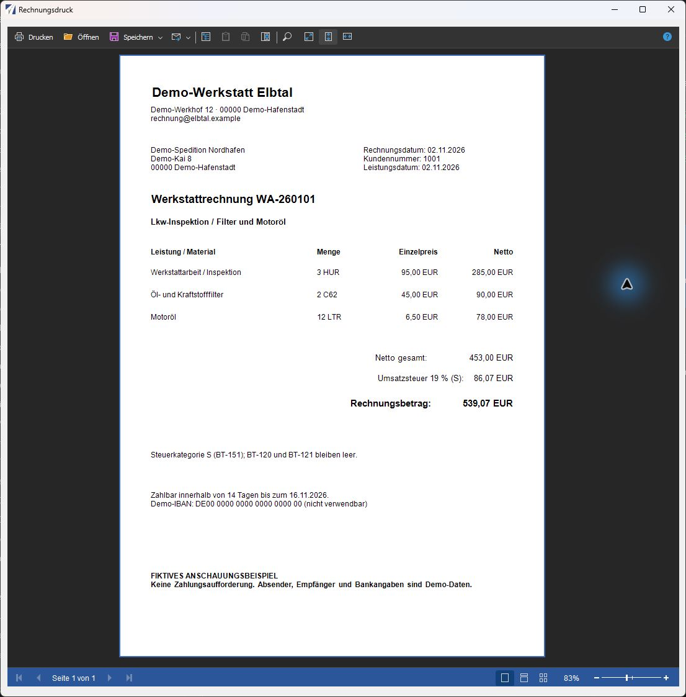

# Vorschau und Berichte

Die Vorschau dient zur Sichtkontrolle von Anschrift, Rechnungspositionen, Mengen, Preisen, Steuern und Zahlungsangaben.

## Eine Rechnung ansehen

1. Wählen Sie **WA**, **TA** oder **MR**.
2. Suchen Sie die Rechnung anhand ihrer Nummer und des Kunden.
3. Klicken Sie in dieser Zeile auf **Bericht**.
4. Kontrollieren Sie das Rechnungsbild im geöffneten Vorschaufenster.

*Original-Anwendungsfenster mit fiktiven Demo-Daten. Die Beispielvorlage zeigt dieselbe Werkstattrechnung WA-260101 wie die Rechnungsübersicht. [Bild in voller Auflösung öffnen](../assets/screenshots/berichtsvorschau-werkstatt.png).*

Prüfen Sie im Beispiel die drei Positionen: **3 HUR** Werkstattarbeit, **2 C62** Filter und **12 LTR** Motoröl. Daraus ergeben sich **453,00 EUR netto**, bei der angenommenen Besteuerung mit **19 % / Kategorie S** weitere **86,07 EUR Umsatzsteuer** und **539,07 EUR Rechnungsbetrag**. Bei Kategorie S bleiben BT-120 und BT-121 leer.

Die Abbildung zeigt eine Beispielvorlage. Ihr Rechnungsbild kann je nach eingerichteter Berichtsvorlage anders aussehen. Die dargestellte Demo-IBAN ist nicht verwendbar; die Beispielrechnung ist keine Zahlungsaufforderung.

## Mehrere Rechnungen ansehen

1. Markieren Sie die gewünschten Zeilen.
2. Wählen Sie unter **Berichte** die Schaltfläche **Ausgewählte anzeigen**.
3. Prüfen Sie die angezeigten Belege einzeln.

**Alle anzeigen** übergibt die Rechnungen der aktuellen Übersicht an das Berichtsfenster. Die genaue Ausgabe und die dort verfügbaren Druckfunktionen hängen von der installierten Berichtsvorlage ab.

## Vor dem Export kontrollieren

Vergleichen Sie Kundenname, Rechnungsadresse, Rechnungs- und Lieferdatum sowie Positionen und Summen mit dem fachlich freigegebenen Beleg. Prüfen Sie die Bankverbindung und die Zahlungsbedingungen.

Fehler in Rechnungs- oder Kundenangaben korrigieren Sie in der zuständigen FLEET-Pflege. Die Rechnungsübersicht ist kein Editor für Rechnungspositionen. Bereits festgeschriebene XML-Daten werden durch eine spätere Stammdatenkorrektur nicht neu erzeugt.

Führen Sie anschließend die [XML-Prüfung über Validator](pruefung.md) aus. Daten, die im Rechnungsbild fehlen oder anders dargestellt werden, können in der XML trotzdem enthalten sein – und umgekehrt.
