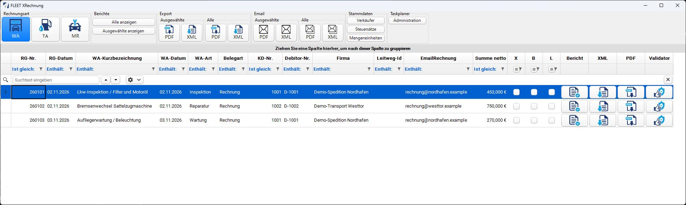
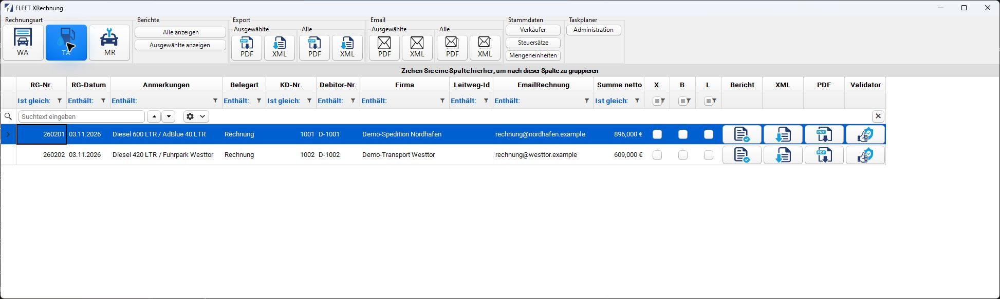

# Endanwender-Handbuch

Dieses Handbuch richtet sich an Mitarbeiter, die vorbereitete FLEET-Rechnungen ansehen, prüfen, exportieren oder per E-Mail versenden. Die Einrichtung übernimmt die zuständige Stammdatenpflege beziehungsweise Administration anhand des separaten Handbuchs [Vorbereitung und Stammdaten](../vorbereitung/index.md).

## Programm öffnen

Starten Sie die bereitgestellte FLEET-XRechnung-Anwendung. Der Startdialog bietet den Programmstart und eine Konfiguration der Datenbankanbindung. Die Verbindung muss bereits durch die Administration eingerichtet sein. Danach erscheint **FLEET XRechnung** mit der Rechnungsübersicht. Auch ein Aufruf aus dem FLEET-Hauptprogramm kann abhängig von der Integration direkt in eine Funktion führen.

Wenn die Übersicht nicht geöffnet wird, beachten Sie die [Hinweise zur Datenbankverbindung](../vorbereitung/technik.md). Ändern Sie eine funktionierende Verbindung nicht zur Fehlerprobe.

## Rechnungsart wählen

| Schaltfläche | Bedeutung | Domäne im Taskplaner |
| --- | --- | --- |
| **WA** | Werkstattrechnung | `Rechnung` |
| **TA** | Tankabrechnung | `Tankabrechnung` |
| **MR** | Manuelle Rechnung | `ManuelleRechnung` |

Beim Öffnen ist WA ausgewählt. Ein Wechsel der Rechnungsart lädt die zugehörige Liste neu. Exportpfade und Verkäuferdaten können je Rechnungsart unterschiedlich sein.

!!! warning "Manuelle Rechnungen im geprüften Stand"
    MR ist in der Oberfläche auswählbar. Im geprüften XML-Exporter fehlt jedoch ein eigener Zweig zur Übernahme der MR-Positionen. Deshalb ist ein vollständiger MR-Export nicht als funktionsfähig bestätigt. Beachten Sie die [bekannten Grenzen](../referenz/bezugsstand.md), bevor Sie MR verwenden.

## Rechnungen auswählen

Klicken Sie auf die gewünschte Datenzeile. Für mehrere Rechnungen verwenden Sie die übliche Mehrfachauswahl mit **Strg** beziehungsweise **Umschalt** und kontrollieren die markierten Zeilen. Eine Auswahl wirkt auf die Schaltflächen unter **Ausgewählte**.

**Alle** startet eine Sammelverarbeitung für die aktuelle Rechnungsart. Prüfen Sie deren Umfang vor der Bestätigung. Verwenden Sie für gezielte oder erstmals geprüfte Rechnungen **Ausgewählte**. Insbesondere bei sortierter oder gefilterter Liste sollte „Alle“ nicht als Zusage eines fachlich eingegrenzten Rechnungsbestands verstanden werden; siehe [Bezugsstand](../referenz/bezugsstand.md).

## Oberfläche im Überblick

| Bereich | Funktion |
| --- | --- |
| **Berichte** | **Ausgewählte anzeigen** oder **Alle anzeigen** öffnet die Druckvorschau |
| **Export** | **XML** oder **PDF**, jeweils für **Ausgewählte** oder **Alle** |
| **Email** | **XML** oder **PDF**, jeweils für **Ausgewählte** oder **Alle** |
| **Stammdaten** | **Verkäufer**, **Mengeneinheiten**, **Steuersätze** |
| **Taskplaner** | **Administration** öffnet den E-Rechnung Task Manager |
| Zeilenspalten | **Bericht**, **XML**, **PDF**, **Validator** für die betreffende Rechnung |

Die Zeilenaktion **XML** beziehungsweise **PDF** startet bereits den Export; sie öffnet keinen reinen Betrachter. **Bericht** ist der Einstieg zum Ansehen.

## Beispiele aus Werkstatt und Fuhrpark

*Original-Anwendungsfenster mit fiktiven Demo-Daten. WA zeigt drei Werkstattrechnungen an die Demo-Spedition Nordhafen und Demo-Transport Westtor. Das Bild lässt sich in voller Auflösung öffnen.*

Die erste Rechnung enthält beispielhaft 3 Stunden Arbeit zu 95,00 EUR, 2 Filter zu 45,00 EUR und 12 Liter Motoröl zu 6,50 EUR: **453,00 EUR netto**. Die zugehörigen Einheiten sind `HUR`, `C62` und `LTR`; bei der hier angenommenen Standardbesteuerung steht `ERechnung_BT151` auf `S`, BT-120 und BT-121 bleiben leer. Die Aufnahme zeigt die Übersicht, keinen Nachweis einer erfolgreichen Festschreibung oder Validierung.

*Original-Anwendungsfenster mit fiktiven Demo-Daten. TA zeigt Diesel- und AdBlue-Abrechnungen; die E-Mail-Adressen unter `.example` sind nicht für einen echten Versand bestimmt.*

Für Nordhafen ergeben **600 Liter Diesel × 1,45 EUR + 40 Liter AdBlue × 0,65 EUR = 896,00 EUR netto**. Beide Mengen werden in diesem Beispiel als `LTR` mit Faktor 1 geführt. Der zweite Beispielbeleg enthält 420 Liter Diesel zu 1,45 EUR und damit 609,00 EUR netto.

Die verwendeten Codes finden Sie in der [offiziellen Einheitenliste](https://docs.peppol.eu/poacc/billing/3.0/codelist/UNECERec20/) und der [Liste der Steuerkategorien](https://docs.peppol.eu/poacc/billing/3.0/codelist/UNCL5305/). Die genaue Stammdatenpflege erläutern [Mengeneinheiten](../vorbereitung/mengeneinheiten.md) und [Steuersätze](../vorbereitung/steuersaetze.md).

## Formate unterscheiden

- **XML** enthält die strukturierten Rechnungsdaten im UBL-Format mit XRechnung-Profil.
- **PDF** in diesem Modul bezeichnet das Hybrid-PDF: eine PDF-Datei mit eingebetteter Rechnungs-XML.
- Die **Druckvorschau** zeigt das Rechnungsbild. Sie ersetzt die Prüfung der strukturierten XML-Daten nicht.

Klären Sie mit dem Empfänger, welches Format und welcher Übermittlungsweg akzeptiert werden. Das Vorhandensein einer XML in einem PDF allein ist keine Aussage über eine bestimmte ZUGFeRD-Konformität oder die Annahme durch ein Portal.

Weiter: [Vorschau und Berichte](berichte.md), [Export](export.md), [E-Mail](email.md) und [Prüfen und Fehler beheben](pruefung.md).
