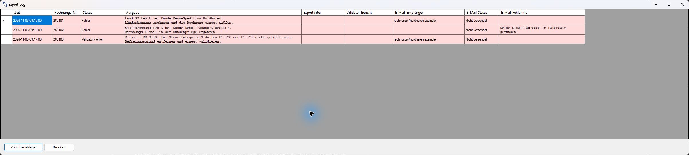

# Prüfen, Protokolle und Fehler

## Rechnung über Validator prüfen

1. Wählen Sie die Rechnungsart und die Rechnung.
2. Klicken Sie in der Zeile auf **Validator**.
3. Lesen Sie das Ergebnis im Protokollfenster.
4. Klicken Sie auf den vorhandenen Pfad in **Validator-Bericht**, um den HTML-Bericht zu öffnen.

Bei einer noch nicht festgeschriebenen Rechnung wird die XML für die Prüfung vorübergehend aus den aktuellen Daten erzeugt. Bei einer festgeschriebenen Rechnung prüft das Programm die gespeicherte XML aus der Datenbank. Diese Aktion dient nicht zur erneuten Festschreibung.

Die vollständige Validierung prüft die technische Struktur und Rechnungsregeln anhand der installierten Validator-Konfiguration. Sie ersetzt weder die Sichtkontrolle noch die Prüfung, ob der Empfänger die fachlich richtige Rechnung erhält. Ein normaler Export ohne Festschreibung führt diese externe Validierung nicht automatisch aus.

## Protokoll lesen

*Original-Anwendungsfenster mit fiktiven Demo-Daten. Die dargestellten Meldungen sind vorbereitete Beispiele zur Erklärung des Protokolls, kein Ergebnis einer echten Kundenverarbeitung. Es wurde keine E-Mail versendet. [Bild in voller Auflösung öffnen](../assets/screenshots/pruefprotokoll-fehler.png).*

Die erste Meldung verweist auf eine fehlende Länderkennung, die zweite auf eine fehlende Rechnungs-E-Mail. Das dritte Beispiel erläutert **BR-S-10**: Bei Steuerkategorie **S** dürfen **BT-120** und **BT-121** nicht gefüllt sein. Die Regel ist bei der [offiziellen Definition des Befreiungsgrundtexts](https://docs.peppol.eu/poacc/billing/3.0/syntax/ubl-invoice/cac-TaxTotal/cac-TaxSubtotal/cac-TaxCategory/cbc-TaxExemptionReason/) beschrieben.

Im Beispiel bleiben die Datei- und Berichtspfade leer. Bei einer tatsächlichen Prüfung öffnen Sie einen vorhandenen HTML-Bericht über **Validator-Bericht**. Ob ein Bericht verfügbar ist, hängt vom jeweiligen Fehlerfall ab.

| Spalte | Bedeutung |
| --- | --- |
| **Zeit** | Zeitpunkt des Protokolleintrags; Einträge werden im Programm mit UTC erzeugt |
| **Rechnungs-Nr.** | Betroffener Beleg; ein allgemeiner Abbrucheintrag kann die Nummer 0 haben |
| **Status** | Gesamtergebnis für den Vorgang |
| **Ausgabe** | Fehlerbeschreibung oder erläuternde Meldung |
| **Exportdatei** | Gemeldeter Dateipfad; bei Bedarf Existenz kontrollieren |
| **Validator-Bericht** | Anklickbarer Pfad zum vorhandenen HTML-Bericht |
| **E-Mail-Empfänger / E-Mail-Status / E-Mail-Fehlerinfo** | Empfänger und Ergebnis des Versandversuchs |

Verlassen Sie sich auf den Meldungstext, nicht allein auf die Zeilenfarbe: Die Farbzuordnung erkennt nur bestimmte Statusformulierungen. Das Protokollfenster bietet außerdem das Kopieren der Tabelle in die Zwischenablage und einen Druckaufruf. Lange Protokolle können im vorhandenen Druckpfad unvollständig auf eine Seite passen; verwenden Sie zur vollständigen Weitergabe bevorzugt die kopierte Tabelle.

HTML-Berichte liegen normalerweise unter `logs/html` beim Programm. Sie werden vom Programm bereinigt; sichern Sie für eine spätere Fehlerklärung benötigte Berichte zeitnah. Ein gespeicherter älterer Pfad muss später nicht mehr existieren. Taskplaner-Logs können vorhandenes Berichtsmaterial für die Anzeige in einen temporären Ordner schreiben.

## Typische Fehler und nächste Schritte

| Meldung / Beobachtung | Vorgehen |
| --- | --- |
| Kennzeichen Land ISO fehlt | [Kunden-Länderkennung](../vorbereitung/kunden.md) pflegen, danach erneut prüfen |
| EMail für Rechnung fehlt / keine E-Mail-Adresse im Datensatz | `EmailRechnung` im richtigen Kunden ergänzen; sie wird auch bei neuem XML-Export verlangt |
| Exportpfad nicht definiert | Für die betreffende Rechnungsart [Verkäuferparameter](../vorbereitung/firma.md) vervollständigen; Übersicht danach neu öffnen |
| Zugriff auf Pfad verweigert | Administration prüft Schreibrechte und Erreichbarkeit des Zielordners unter dem tatsächlich verwendeten Windows-Benutzer |
| Validator nicht installiert / Validator-Konfiguration fehlt / Java fehlt | Administration prüft [Voraussetzungen](../vorbereitung/technik.md) |
| Steuerkategorie oder Befreiungsgrund wird beanstandet | [Steuerfelder](../vorbereitung/steuersaetze.md), konkreten Steuersatz und bereits in die Rechnung übernommene Werte abgleichen |
| Einheit stimmt nicht, obwohl der Export erfolgreich ist | [Unitcode und Faktor](../vorbereitung/mengeneinheiten.md) prüfen; unbekannte Codes können auf `C62` zurückfallen |
| Kein XML in der Datenbank gefunden | Festgeschriebenen Beleg durch Administration prüfen lassen; Stammdatenänderung ersetzt den fehlenden gespeicherten Beleg nicht |
| SMTP-Server / Absender fehlt oder Versand fehlgeschlagen | [SMTP-Parameter](../vorbereitung/technik.md), TLS und Zugang prüfen lassen; vor erneutem Versand Status je Rechnung prüfen |
| Übersicht meldet Datenbankfehler bei leerer Rechnungsart | Die Meldung kann auch bei einer leeren Rechnungsliste auftreten; Verbindung und vorhandene Belege durch Administration prüfen lassen |
| MR-XML enthält keine erwarteten Positionen | Verarbeitung anhalten und die Positionsübernahme mit der Administration klären |

## Fehlerfall geordnet bearbeiten

Notieren Sie Rechnungsart, Rechnungsnummer, Aktion, Zeitpunkt und die genaue Meldung. Öffnen Sie den Validator-Bericht und korrigieren Sie die Ursache in der zuständigen Pflege. Prüfen Sie anschließend dieselbe einzelne Rechnung erneut. Weiten Sie die Verarbeitung erst nach erfolgreicher Kontrolle aus.

Bei Fehlern können bereits Festschreibungen, Exportdateien oder E-Mails entstanden sein. Das Wiederholen eines gesamten Laufs ist daher keine sichere Rücksetzung. Geben Sie Protokolle mit Kunden- oder Verbindungsdaten nur an die zuständige Stelle weiter.
