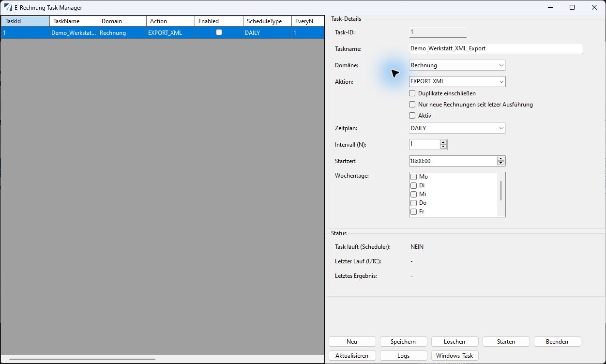

# Taskplaner

Unter **Taskplaner → Administration** öffnen Sie den **E-Rechnung Task Manager**. Er verwaltet Aufgaben in der Datenbank und zugehörige Einträge der Windows-Aufgabenplanung. Er ist für regelmäßige Exporte und E-Mail-Läufe vorgesehen.

*Original-Anwendungsfenster mit fiktiven Demo-Daten. Der dargestellte Plan ist deaktiviert, hat noch keinen Lauf und wurde nicht als Windows-Aufgabe registriert. [Bild in voller Auflösung öffnen](../assets/screenshots/taskplaner.png).*

Das Beispiel verwendet die Domäne `Rechnung` für WA, die Aktion `EXPORT_XML` und `DAILY` mit Intervall 1 um 18:00 Uhr. **Aktiv**, **Duplikate einschließen** und **Nur neue Rechnungen seit letzer Ausführung** sind ausgeschaltet. Die Aufnahme erklärt die Felder und bestätigt keinen ausgeführten Export.

## Voraussetzungen

Vorher müssen ein manueller Export und gegebenenfalls der E-Mail-Versand für die betreffende Rechnungsart erfolgreich geprüft sein. Die Anwendung, die Datenbank, der Validator und die Ausgabepfade müssen unter dem Benutzer der Aufgabe erreichbar sein.

Die vorhandene Registrierung verwendet einen interaktiven Windows-Benutzer und fordert die höchste Ausführungsstufe an. Sie ist kein eingerichteter Hintergrunddienst für einen abgemeldeten Benutzer. Die Administration prüft die tatsächlichen Windows-Berechtigungen und die Anmeldung. Die automatische Verarbeitung benutzt den Programmaufruf `--run-task <TaskId>`.

## Aufgabe anlegen

1. Klicken Sie auf **Neu**. Die Task-ID wird geleert; sie entsteht beim Speichern.
2. Vergeben Sie einen eindeutigen **Taskname** oder lassen Sie das Feld für einen automatisch erzeugten Namen leer.
3. Wählen Sie **Domäne** und **Aktion** aus den folgenden Tabellen.
4. Stellen Sie **Zeitplan**, **Intervall (N)** und gegebenenfalls **Startzeit** und **Wochentage** ein.
5. Prüfen Sie **Aktiv**, **Duplikate einschließen** und **Nur neue Rechnungen seit letzer Ausführung**.
6. Klicken Sie auf **Speichern** und prüfen Sie jede Meldung zur Windows-Aufgabenplanung.

Ein neuer Editor setzt standardmäßig `Rechnung`, `EMAIL_PDF`, **Aktiv**, `DAILY`, Intervall 1 und 02:00 Uhr. Beide Einschränkungsoptionen sind zunächst ausgeschaltet. Ändern Sie diese Vorgaben bewusst, bevor Sie speichern. Eine aktive Aufgabe wird bereits beim Speichern in Windows angelegt oder aktualisiert.

| Domäne | Rechnungsart |
| --- | --- |
| `Rechnung` | WA – Werkstattrechnung |
| `Tankabrechnung` | TA – Tankabrechnung |
| `ManuelleRechnung` | MR – bekannte [Positionsgrenze](../referenz/bezugsstand.md) beachten |

| Aktion | Ergebnis |
| --- | --- |
| `EXPORT_XML` | XML in den Ausgabepfad exportieren |
| `EXPORT_PDF` | Hybrid-PDF in den Ausgabepfad exportieren |
| `EMAIL_XML` | XML an `EmailRechnung` versenden |
| `EMAIL_PDF` | Hybrid-PDF an `EmailRechnung` versenden |

Die Aufgabe verarbeitet ihren eigenen Rechnungsbestand zur Domäne; eine Auswahl in der Rechnungsübersicht begrenzt sie nicht. Noch nicht festgeschriebene Belege werden vom automatischen Export beziehungsweise Versand zur Festschreibung verarbeitet. Es erscheinen dabei nicht die einzelnen Bestätigungsfragen des manuellen Exports.

## Zeitpläne richtig einstellen

| Zeitplan | Bedeutung von N | Startzeit / Wochentage |
| --- | --- | --- |
| `MINUTELY` | Wiederholung alle N Minuten | Start ungefähr eine Minute nach Registrierung; eingetragene Startzeit wird nicht verwendet |
| `HOURLY` | Wiederholung alle N Stunden | Start ungefähr eine Minute nach Registrierung; eingetragene Startzeit wird nicht verwendet |
| `DAILY` | Wiederholung alle N Tage | Zur Startzeit; liegt diese heute bereits zurück, wird der Start auf morgen gesetzt |
| `WEEKDAYS` | Wiederholung alle N Wochen | Zur Startzeit an den markierten Wochentagen; mindestens einen Tag auswählen |

Die Trigger verwenden die lokale Windows-Zeit. **Letzter Lauf (UTC)** wird dagegen ausdrücklich in UTC angezeigt. Bei `WEEKDAYS` ist N also kein Tagesabstand. Die Minuten-/Stunden-Wiederholung wird mit einer Dauer von 3650 Tagen registriert.

## Duplikate und neue Rechnungen

**Duplikate einschließen** ist standardmäßig ausgeschaltet. Bereits festgeschriebene Rechnungen werden dann mit **Übersprungen (Duplikat)** protokolliert. Eingeschaltet erlaubt die Option auch ihre erneute Verarbeitung beziehungsweise ihren erneuten Versand. Eine Festschreibung sagt nicht aus, ob eine frühere E-Mail tatsächlich erfolgreich versendet wurde.

**Nur neue Rechnungen seit letzer Ausführung** verwendet tatsächlich das Ende des letzten **erfolgreichen** Laufs als Grenze. Verglichen wird das Feld **Rechnungsdatum**, nach Umrechnung der Grenze in lokale Zeit. Nur ein späteres Datum bleibt im Bestand. Ohne vorherigen erfolgreichen Lauf werden alle passenden Rechnungen berücksichtigt; fehlt die Datumsspalte, wird der Filter ausgelassen, und nicht lesbare Datumswerte bleiben enthalten.

!!! warning "Rückdatierte und taggleiche Belege"
    Der Filter prüft nicht das Erfassungs- oder Änderungsdatum. Eine heute später erfasste Rechnung mit Rechnungsdatum heute 00:00 Uhr kann nach einem erfolgreichen Lauf um 10:00 Uhr herausfallen. Verwenden Sie diese Option erst, wenn sie zum eigenen Rechnungsprozess passt. Sie ersetzt keine Kontrolle nachträglich erfasster Belege.

Bei automatischem E-Mail-Versand wird eine fehlende Empfängeradresse als **Übersprungen (kein Empfänger)** protokolliert. Ein Lauf kann trotz übersprungener Rechnungen erfolgreich sein. Prüfen Sie deshalb immer die Einzelmeldungen.

## Aufgabe bearbeiten und bedienen

Wählen Sie eine Aufgabe in der Liste, ändern Sie die Felder und klicken Sie auf **Speichern**. Die Änderungen werden zuerst in der Datenbank gespeichert. Scheitert anschließend die Registrierung in Windows, bleiben die Datenbankänderungen bestehen. Die Aufgabe ist damit noch nicht zuverlässig ausführbar.

| Schaltfläche | Wirkung |
| --- | --- |
| **Windows-Task aktualisieren** | Registriert den gespeicherten Plan erneut; ungespeicherte Editoränderungen werden nicht übernommen |
| **Starten** | Registriert den gespeicherten Plan und startet ihn über Windows unmittelbar; kann echte Exporte oder E-Mails auslösen |
| **Beenden** | Stoppt die Windows-Aufgabe; bereits erzeugte oder versendete Belege bleiben verarbeitet |
| **Aktualisieren** | Lädt Aufgabenliste und Status neu |
| **Logs** | Öffnet die Einzeleinträge des letzten gespeicherten Laufs der ausgewählten Aufgabe |
| **Löschen** | Fragt nach Bestätigung und entfernt den Plan; das Stoppen und Löschen des Windows-Tasks wird ebenfalls versucht |

Zum Deaktivieren **Aktiv** abwählen und **Speichern** klicken. Dabei wird der Windows-Task entfernt; ein bereits laufender Prozess ist bei Bedarf separat mit **Beenden** zu stoppen. **Windows-Task aktualisieren** ist kein Deaktivierungsschalter: Die Funktion registriert den Plan unabhängig von dieser Editorabsicht erneut. Der Runner selbst bricht einen deaktivierten Plan ohne Verarbeitung ab.

Behalten Sie den registrierten Tasknamen bei. Eine Namensänderung registriert den neuen Namen; eine automatische Bereinigung des alten Namens ist nicht implementiert. Die Administration prüft in einem solchen Fall auf alte Einträge unter `\EHFleetXRechnung`.

## Status und Protokolle kontrollieren

**Task läuft (Scheduler)** zeigt JA/NEIN, dazu erscheinen **Letzter Lauf (UTC)** und **Letztes Ergebnis**. Ein NEIN allein beweist keine erfolgreiche Registrierung: Auch eine fehlende Aufgabe oder eine fehlgeschlagene Statusabfrage kann so erscheinen. Über **Logs** wird der neueste Lauf angezeigt; eine freie Auswahl älterer Läufe ist im geprüften Dialog nicht implementiert.

Bei der Meldung, dass der Windows-Task nicht angelegt werden konnte, lassen Sie Berechtigungen, Programmpfad und Aufgabenplanung prüfen. Nach **Löschen** muss die Administration bei Bedarf kontrollieren, ob ein Windows-Eintrag übrig geblieben ist, weil Fehler bei dessen Entfernung im Dialog unterdrückt werden.

Automatische Wiederholungen starten bei einer bereits laufenden Instanz derselben Windows-Aufgabe keine zweite Instanz. Verschiedene Aufgaben können dennoch denselben Rechnungsbestand betreffen. Vermeiden Sie überlappende Versandpläne und kontrollieren Sie [Einzelergebnisse und Fehler](pruefung.md).
