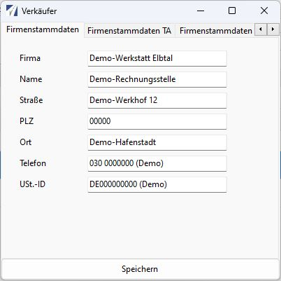
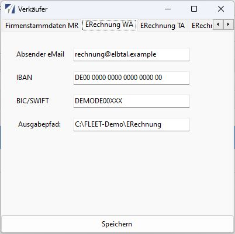

# Firmenstammdaten und Verkäufer

Öffnen Sie **Stammdaten → Verkäufer**. Der Dialog hat drei Register für die Firmenangaben und drei weitere für die E-Rechnung-Einstellungen. Pflegen Sie jede tatsächlich verwendete Rechnungsart; eine automatische Übernahme der WA-Werte auf TA oder MR ist nicht vorgesehen.

## Register und Parameterzuordnung

| Rechnungsart | Firmenregister / ParameterNr | E-Rechnung-Register / ParameterNr |
| --- | --- | --- |
| WA | **Firmenstammdaten** / `1` | **ERechnung WA** / `211` |
| TA | **Firmenstammdaten TA** / `11` | **ERechnung TA** / `1211` |
| MR | **Firmenstammdaten MR** / `21` | **ERechnung MR** / `2211` |

Die Parameternummern dienen zur eindeutigen Zuordnung bei Rückfragen an die Administration. Im normalen Ablauf verwenden Sie die beschrifteten Eingabefelder.

## Beispiel: Demo-Werkstatt Elbtal

*Original-Anwendungsfenster mit fiktiven Demo-Daten. Firma, Anschrift und Kontakt sind erfunden; `DE000000000 (Demo)` ist ausdrücklich keine gültige Umsatzsteuer-ID. [Bild in voller Auflösung öffnen](../assets/screenshots/verkaeufer-firmenstammdaten.png).*

Der Screenshot zeigt das Register **Firmenstammdaten** für WA. Die Register für TA und MR werden getrennt gepflegt. Die Platzhalter dienen ausschließlich der Erklärung der Eingabefelder und sind nicht für eine produktive Rechnung oder einen erfolgreichen Validierungstest vorgesehen.

## Firmenangaben

| Feld im Dialog | Verwendung und Vorbereitung |
| --- | --- |
| **Firma** | Rechtlicher Verkäufername; wird auch als Kontaktname der E-Rechnung verwendet |
| **Name** | Im Dialog gespeichert, aber vom geprüften XML-Exporter nicht als eigener Ansprechpartner übernommen |
| **Straße**, **PLZ**, **Ort** | Vollständige Verkäuferanschrift |
| **Telefon** | Telefon des Verkäuferkontakts; für die deutsche XRechnung-Validierung vollständig pflegen |
| **USt.-ID** | Umsatzsteuer-Identifikationsnummer des Verkäufers; intern im Parameterfeld `Steuernummer` gespeichert |

!!! warning "USt.-ID und interne Feldbezeichnung"
    Der Exporter übergibt den Inhalt von `Steuernummer` mit dem Schema `VA` als Umsatzsteuer-ID. Tragen Sie in das als **USt.-ID** beschriftete Feld daher die zutreffende Umsatzsteuer-ID ein. Eine inländische Steuernummer wird durch diese Feldbezeichnung nicht automatisch zu einer passenden Umsatzsteuer-ID. Ein eigener Exportpfad für eine alternative steuerliche Registrierung ist hier nicht belegt.

Der Verkäufer-Ländercode wird im geprüften Exporter fest auf **DE** gesetzt. Eine ausländische Verkäuferanschrift lässt sich deshalb nicht allein durch geänderte Adresszeilen korrekt abbilden.

Bei WA verwendet die Pflege intern `Straße`, bei TA/MR `Strasse`; der Exporter liest durchgehend `Straße`. Ob die Datenbank beide Angaben passend bereitstellt, ist installationsabhängig zu prüfen. Kontrollieren Sie insbesondere die tatsächliche Verkäuferstraße in einer TA- beziehungsweise MR-XML; siehe [Bezugsstand](../referenz/bezugsstand.md).

## Ergänzende E-Rechnung-Angaben

| Feld im Dialog | Internes Feld | Verwendung |
| --- | --- | --- |
| **Absender eMail** | `Modul1` | Elektronische Verkäuferadresse mit Schema `EM` und E-Mail des Verkäuferkontakts in der XML |
| **IBAN** | `Modul2` | Gläubigerkonto für die im Export verwendete Überweisung |
| **BIC/SWIFT** | `Modul3` | Kennung des Kreditinstituts, soweit im konkreten Fall erforderlich |
| **Ausgabepfad** | `Ausgabepfad` | Basisordner für Exportdateien dieser Rechnungsart |

Der Exporter kann zusätzlich `Modul4` als Bankname lesen. Dafür gibt es im geprüften Verkäuferdialog kein Eingabefeld. Falls benötigt, lässt die Administration den Wert über die zuständige vorhandene Parameterpflege setzen.

**Absender eMail** ist eine Rechnungsangabe. Die tatsächlich für den E-Mail-Versand verwendete Absenderadresse stammt separat aus SMTP-Parameter 6101. Stimmen Sie beide miteinander ab; der Verkäuferdialog richtet den Versandserver nicht ein.

*Original-Anwendungsfenster mit fiktiven Demo-Daten. `rechnung@elbtal.example`, die IBAN mit Prüfziffern `00` und `DEMODE00XXX` sind Demo-Platzhalter. Sie bilden keine verwendbare Versand- oder Bankkonfiguration. [Bild in voller Auflösung öffnen](../assets/screenshots/verkaeufer-erechnung-wa.png).*

Die Eingabeprüfung kontrolliert bei der IBAN nur eine Mindestlänge von 15 Zeichen und bei der BIC eine Länge von 8 bis 11 Zeichen. Eine erfolgreiche Eingabe bestätigt daher keine fachlich gültige Bankverbindung.

## Ausgabepfad einrichten

Verwenden Sie einen Ordner, den der ausführende Windows-Benutzer beschreiben kann, beispielsweise `C:\FLEET\ERechnung`. Das Programm ergänzt darunter je Rechnungsart `Werkstatt`, `Tanken` oder `Manuell` und erzeugt den Unterordner bei Bedarf.

Bei Netzlaufwerken muss die Erreichbarkeit auch unter dem Benutzer eines späteren Taskplaner-Laufs gegeben sein. Die Kontrolle des tatsächlichen Schreibzugriffs übernimmt die Administration. Es erfolgt keine zuverlässige vollständige Zugriffsprüfung allein durch das Speichern des Eingabefelds.

## Speichern und kontrollieren

1. Prüfen Sie alle benötigten Register.
2. Klicken Sie auf **Speichern**; der Dialog speichert die Angaben aller Register und meldet **Alle Daten gespeichert**.
3. Schließen Sie den Dialog. Öffnen Sie die Rechnungsübersicht nach einer Pfadänderung erneut, weil der Exporter die Pfade beim Erzeugen seiner Instanz einliest.
4. Erzeugen und validieren Sie eine einzelne Beispielrechnung je verwendeter Rechnungsart und kontrollieren Sie die ausgegebenen Verkäuferdaten.

Die Speichermeldung allein bestätigt noch keine vollständigen oder normkonformen Rechnungsdaten. Weiter: [Kunden](kunden.md) und [Checkliste](checkliste.md).
